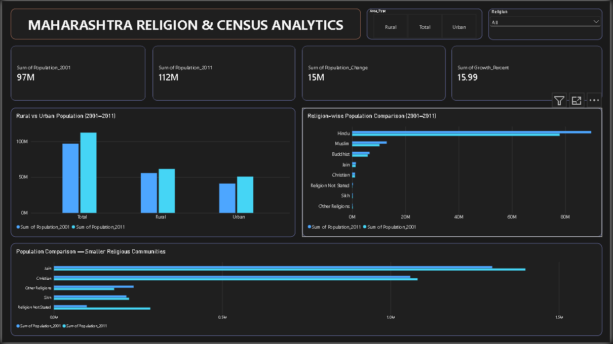
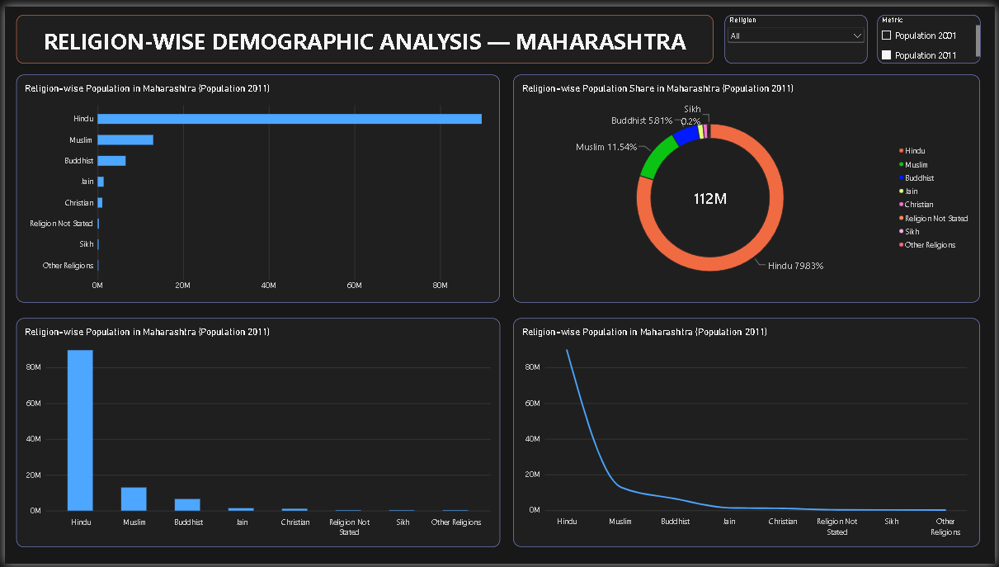
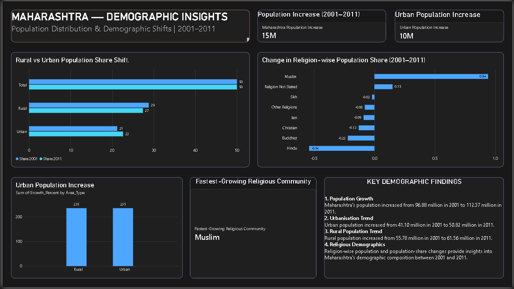

# 📊 Maharashtra Religion Demographics & Census Trend Analysis

An interactive **Power BI dashboard** analyzing Maharashtra's population demographics, religion-wise population distribution, and Census trends from 2001 to 2011.

## 📌 Project Overview

This project analyzes Maharashtra Census data from 2001 and 2011 to explore population growth, rural–urban distribution, and religion-wise demographic changes.

The Power BI dashboard presents key statistics and demographic insights through interactive charts, KPI cards, and comparative visualizations.

## 🎯 Project Objectives

* Analyze Maharashtra's population growth between 2001 and 2011.
* Compare rural and urban population trends.
* Explore religion-wise population distribution.
* Compare religion-wise population shares across Census years.
* Present demographic insights through interactive Power BI visualizations.

## 🛠️ Tools & Technologies

* **Power BI Desktop** — Dashboard development and visualization
* **Power Query** — Data cleaning and transformation
* **DAX** — Measures and calculations
* **CSV** — Census datasets
* **Python / Jupyter Notebook** — Census comparison analysis, where included in the project

## 📸 Dashboard Screenshots

### 1. Maharashtra Overview

Overview of Maharashtra's population, population growth, and rural–urban distribution.



### 2. Religion Analysis

Religion-wise population comparison, population distribution, and changes between 2001 and 2011.



### 3. Demographic Insights

Highlights demographic changes, rural–urban population shifts, and religion-wise population share changes.



## 📈 Key Findings

| Metric                        |       Value |
| ----------------------------- | ----------: |
| Population in 2001            |  96,878,627 |
| Population in 2011            | 112,374,333 |
| Total Population Increase     |  15,495,706 |
| Population Growth (2001–2011) |      15.99% |
| Rural Population in 2011      |  61,556,074 |
| Urban Population in 2011      |  50,818,259 |
| Urban Population Increase     |   9,717,279 |

*Source: Maharashtra Census data for 2001 and 2011.*

## 📂 Project Structure

```text
Maharashtra-Religion-Demographics-Census-Analysis/
│
├── data/
│   ├── census_2001_cleaned.csv
│   ├── census_2011_cleaned.csv
│   ├── maharashtra_population_comparison.csv
│   └── religion_comparison_2001_2011.csv
│
├── notebooks/
│   └── 03_census_comparison.ipynb
│
├── screenshots/
│   ├── maharashtra_overview.png
│   ├── religion_analysis.png
│   └── demographic_insights.png
│
├── dashboard/
│   └── Maharashtra_Religion_Demographics.pbix
│
├── docs/
│   └── data_dictionary.md
│
└── README.md
```

*Note: The folder structure above is illustrative. Make sure it matches the actual files in your repository.*

## 🚀 How to Use

1. Browse the screenshots above to preview the dashboard.
2. Open the repository's `.pbix` file.
3. Download the file and open it using **Microsoft Power BI Desktop**.
4. Explore the available dashboard pages, charts, filters, and demographic comparisons.
5. Review the CSV datasets and notebooks, if included, to understand the analysis.

> **Important:** GitHub does not display `.pbix` files as interactive reports. Download the file and open it in Power BI Desktop to explore the dashboard.

## 👨‍💻 Author

**Aditya Pravin Borgaonkar**

B.Tech — Computer Science Engineering (Artificial Intelligence & Analytics)
Pune, Maharashtra, India

* **GitHub:** [@aditya280505](https://github.com/aditya280505)
* **Project Repository:** [Maharashtra Religion Demographics & Census Trend Analysis](https://github.com/aditya280505/Maharashtra-Religion-Demographics-Census-Analysis)

---

⭐ If you find this project useful, consider starring the repository.
